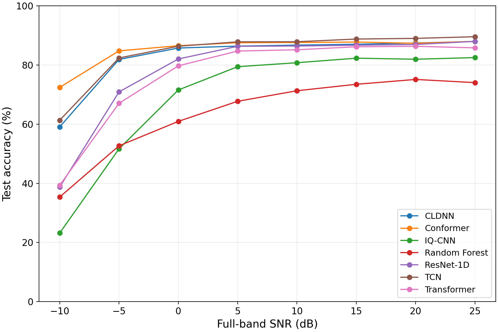
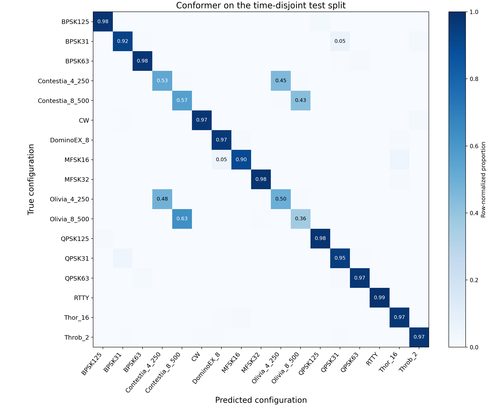

# HFDigiSet: Fldigi-Derived HF Digital-Mode I/Q Dataset for Signal Recognition

Source recording, corrected dataset generation, visualization, and baseline
evaluation for an audio-derived, channel-augmented HF recognition benchmark.

**Version scope matters.** This revision validates **17 fine-grained
configurations in nine parent families**, not 139 corrected classes or 17
parent families. Historical data and results are not relabeled as revised data.

## Data Versions and Access

| Component | Identifier / location | Scope |
| --- | --- | --- |
| Revised benchmark | [10.5281/zenodo.23795076](https://doi.org/10.5281/zenodo.23795076) | 17 regenerated configurations; 163,200 vectors |
| Screened sources | Revised source ZIP | 33 WAV/payload/control-record sets: 17 benchmark sources plus 16 additional screened recordings |
| Historical release | [10.5281/zenodo.20755739](https://doi.org/10.5281/zenodo.20755739) | Historical 17-class and 139-label arrays; not the corrected benchmark |

The revised DOI was reserved by the owner. Public download availability was
**not verified when this repository update was prepared**. Check its Zenodo
record for the live publication/access state; a reserved DOI is not evidence
that files are already public. Frozen metadata records preparation state, not
a live status monitor. Do not substitute the historical DOI to reproduce revised
results. See [the correction notice](revision_v2/DATA_CORRECTION_NOTICE.md).

Three historical OFDM requests fell back to BPSK31 and are excluded. Another
103 historical source entries still require complete review. Screening 33
recordings does not establish 33 validated array classes, and control readbacks
and spectrum checks are not independent RSID/payload decoding.

## Benchmark Specification

| Property | Revised benchmark |
| --- | --- |
| Configurations / parent families | 17 / 9 |
| Vectors | 163,200 |
| Representation | `complex64`, shape `(163200, 2048)` |
| Sample rate / vector duration | 6000 Hz / approximately 341.3 ms |
| Target SNRs | -10, -5, 0, 5, 10, 15, 20, 25 dB |
| Vectors per configuration/SNR | 1200 **total across four profiles** |
| Train / validation / test | 114,240 / 24,480 / 24,480 |
| Frequency / phase offset | Uniform +/-250 Hz / uniform [0, 2 pi) |
| New recordings | Fldigi 4.2.11; 60 s, 16 kHz, mono PCM-24; one payload/recording per configuration |

SNR is clean post-channel, unit-power crop power divided by complex AWGN power
over the **full 6 kHz complex sampling bandwidth**. It is not equal in-band SNR
across modes. Received vectors are not renormalized after adding noise.

| Profile ID | Name | Relative delay (ms) | Gaussian Doppler PSD spread (Hz, 2 sigma) |
| --- | --- | --- | --- |
| 0 | good | 0.5 | 0.1 |
| 1 | moderate | 1.0 | 0.5 |
| 2 | poor | 2.0 | 1.0 |
| 3 | flutter | 0.5 | 10.0 |

Every configuration/SNR/profile cell contributes **210/45/45** vectors to
train/validation/test. Profiles are balanced, not sampled into unspecified quotas.
The Python Watterson-type implementation is numerically checked against its
stated Gaussian-PSD definition; this is **not formal ITU simulator certification**
and does not call the external PathSim executable.

Exact zero-based configuration IDs are in [mode_names.json](data/schema/mode_names.json).
The nine families are PSK, Contestia, CW, DominoEX, MFSK, Olivia, RTTY, Thor,
and Throb. See [the data dictionary](data/release_2.0.0-rc1/data_dictionary.json)
for fields and units.

## Install

Use Python 3.10 or newer for the current portable checkout. The historical
experiment environment was Python 3.9.19, PyTorch 2.0.1+cu117 and an RTX 4090;
[requirements-recorded.txt](revision_v2/requirements-recorded.txt) records
observed versions, not a cross-platform install lock. Use the frozen Zenodo
snapshot for the exact archived software environment.

```powershell
python -m pip install -r requirements.txt
```

Install the PyTorch build appropriate for your CPU/CUDA environment. Array
generation needs NumPy/SciPy; training also needs PyTorch and scikit-learn.
Recording requires Fldigi and an audio-routing device such as
[VB-CABLE](https://vb-audio.com/Cable/). Device IDs are machine-specific.

## Download and Extract

Get the version-specific files from the revised Zenodo record once published.
Do not commit arrays, audio, model weights or archive ZIPs to this repository.

| Archive | Extract into this checkout |
| --- | --- |
| `benchmark_17_2.0.0-rc1.zip` | `revision_v2/benchmark_17/` (with `X.npy` directly inside) |
| `screened_sources_33_2.0.0-rc1.zip` | `revision_v2/` (creates `raw_verified/` and `raw_priority/`) |
| `diagnostics_and_results_2.0.0-rc1.zip` | `revision_v2/` to inspect archived runs and paired-window arrays |

The separate `code_snapshot_2.0.0-rc1.zip` is the **frozen run snapshot**, not an
overlay for this checkout. Its original two-sibling-directory layout is
documented in its README. This GitHub checkout uses root-level training sources
and portable entry points. Exact unchanged scientific sources and explicit
portability differences are tracked by [the snapshot mapping](data/frozen_source_mapping.json)
and [compatibility notes](revision_v2/README.md).

Verify all downloaded upload files before extraction:

```powershell
python scripts/verify_download.py --root "E:\HFDigiSet_downloads"
```

This checks file sizes and SHA-256 against the bundled frozen manifest; it does
not assert that a DOI is public. Then verify the extracted dataset:

```powershell
python revision_v2/verify_dataset.py revision_v2/benchmark_17
```

## Record New Sources

For the existing benchmark, rebuild from the supplied WAVs. A new payload/audio
capture is a **new realization**, not the same frozen benchmark.

In Fldigi, select PortAudio playback `CABLE Input`, enable XML-RPC on
`127.0.0.1:7362`, and disable physical rig/PTT control for this audio-only
workflow. Python records `CABLE Output`. Do not route general system audio into
the cable. The script disables and reads back TX/RX RSID, AFC and reverse,
checks actual modem/carrier, and monitors TX during capture.

```powershell
python revision_v2/record_verified_sources.py --list-devices
python revision_v2/record_verified_sources.py --device-id YOUR_DEVICE_ID --out-root revision_v2/raw_new --modes benchmark --duration-sec 60 --record-fs 16000
```

Replace `YOUR_DEVICE_ID` with your actual input device number. Inspect failures
and saved payload/control/spectral records; a folder name alone does not verify
mode identity. The old all-modem recorder is retained for historical use,
not as a validated 139-class v2 workflow.

## Rebuild the Dataset

```powershell
python build_datasets.py --raw-root revision_v2/raw_verified --out-root revision_v2/rebuilt_benchmark --expected-modes 17 --vectors-per-mode-snr 1200 --seed 20261029
python revision_v2/verify_dataset.py revision_v2/rebuilt_benchmark
```

`build_datasets.py` and `build_all_dataset.py` now delegate to corrected
`revision_v2/build_verified_dataset.py`. Old WAV-only flags belong to the
archived generators in [legacy/](legacy/README.md), not this benchmark.
Only passing `recording.json` sources are accepted. New output directories are
required; existing datasets are never overwritten. Do not build from all 33
sources and call the different array the reported 17-class benchmark.

Source time [3,59) s is partitioned into [3,42.2), [42.2,50.6), [50.6,59)
**before** Hilbert conversion, downmixing, resampling and fading. Main-benchmark
guards are 0.5 s at both ends. The complex-baseband mean is retained. Fading is
independent across mode/profile/split, but crops/fading may overlap **within**
a split. All splits still share one recording/payload per configuration:
raw-time-disjoint does not mean recording-, message-, or OTA-independent.

## Visualize

```powershell
python visualize_iq_samples.py --dataset-root revision_v2/benchmark_17 --random 12 --out-dir visualizations
python validation_figures/plot_compact_examples.py
```

The first command plots I and Q versus time, unsynchronized I/Q scatter,
spectrum and spectrogram. The second recreates the compact four-mode quality
figure, including local PSD zooms, from saved example indices.

## Train, Validate and Test

Revised loaders honor `benchmark_split_indices.npz`. A time-disjoint dataset
without that file is rejected instead of randomly split again. Use fresh output
folders; do not train over archived runs.

```powershell
python revision_v2/train_suite.py --dataset-root revision_v2/benchmark_17 --out-dir revision_v2/reproduced_runs --models conformer,iq_cnn,resnet1d,cldnn,tcn,transformer --seeds 20261029 --epochs 30 --jobs 1 --device cuda
python revision_v2/train_classical_baseline.py --dataset-root revision_v2/benchmark_17 --out-dir revision_v2/reproduced_rf/seed_20261029 --seed 20261029
```

Use `--device cpu` without CUDA; speed and numerical results may differ. Repeat
Conformer in a new output folder with `--models conformer --seeds 20261029,20261030,20261031`.
Repeat Random Forest with `--seed` and separate output folders. The other five
neural architectures have not been evaluated over multiple training seeds.

Export new run plots/CSVs without overwriting the frozen reference CSVs:

```powershell
python revision_v2/make_revision_results.py --dataset-root revision_v2/benchmark_17 --raw-root revision_v2/raw_verified --runs revision_v2/reproduced_runs --out revision_v2/reproduced_results
```

### Recorded Results, Not New Training

| Model | Reference test accuracy (%) |
| --- | ---: |
| Conformer | 85.26 |
| TCN | 84.15 |
| CLDNN | 82.79 |
| ResNet-1D | 78.27 |
| Transformer | 76.80 |
| IQ-CNN | 69.18 |
| Random Forest | 63.84 |

Reference seed: **20261029**, 24,480 test vectors. Only Conformer and Random
Forest have three-seed 17-class results: **85.37 +/- 0.10%** and **63.76 +/- 0.07%**
accuracy (sample SD). The 85.26% reference score is not the three-seed mean.
CSVs: [reference results](revision_v2/results/) and
[repeat/duration results](revision_v2/supplementary_experiments_20261030/).





The paired 2048/8192-point diagnostic covers four Olivia/Contestia configurations,
12,800 vectors per length, with IQ-CNN and Random Forest over three seeds. It
does not establish coding causality, a Conformer duration result or a new
17-class score. See [revision_v2/README.md](revision_v2/README.md).

## Tests, Licenses and Citation

```powershell
python -m unittest discover -s tests -v
python revision_v2/test_pipeline.py
```

Tests use synthetic fixtures, not released research samples. Source code is
[MIT licensed](LICENSE); the dataset is [CC BY 4.0](data/release_2.0.0-rc1/LICENSE_DATA.txt).
Third-party programs retain their licenses. Confirmed dataset creator:
**Junwei Li**; manuscript authorship is separate. [CITATION.cff](CITATION.cff)
provides citation metadata. Cite the data version actually used. Numerical
checks are not a guarantee of cross-platform bitwise replay.
